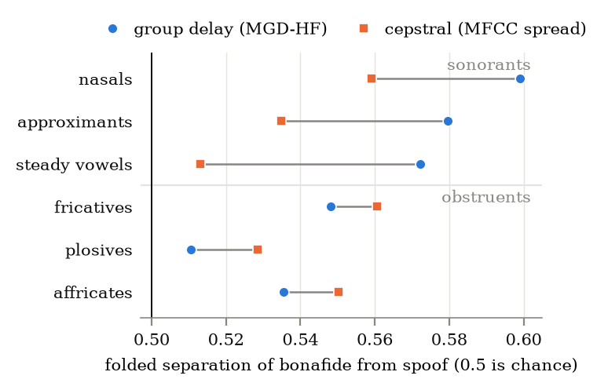
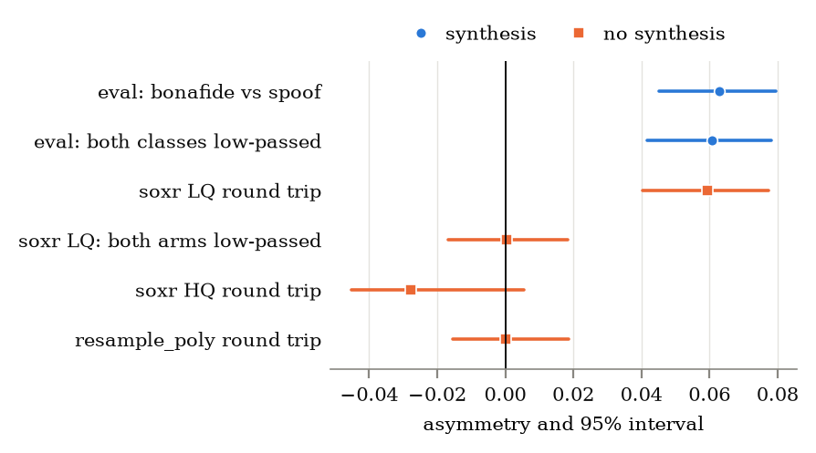

# PhonoPhase

**Where in speech does a deepfake differ from a real voice, and what does the
difference depend on?**

This is the first experiment in a line of work on speech deepfakes. Detectors
already tell real from synthetic speech very well on the data they were trained
on, and much less well on a new synthesiser, a new channel or a new language.
One reason is that nobody can say what they have learned. This project works on
that gap from the measurement side: instead of training a model, it takes one
simple, interpretable statistic and asks where in the speech signal it carries
information, sound class by sound class.

## What we are trying to do

1. **Locate the cue.** Cut every utterance into phones, group them by how they
   are produced (vowels, nasals, approximants, fricatives, stops, affricates),
   and measure how well a statistic separates real from synthetic speech inside
   each group.
2. **Test one specific idea.** The starting idea was that vocoders handle
   voiced, periodic sounds differently from noisy ones, so a phase statistic
   might help most in sonorants. That was written down as a hypothesis, with the conditions that
   would refute it, before the evaluation data was touched.
3. **Find out what causes it.** A pattern is only useful if it comes from the
   synthesis and not from the corpus: its sample rate history, its band edges,
   its speakers. Most of the work here is controls built to tell those apart.
4. **Then ask whether it transfers.** If the cue is tied to how sounds are
   produced and not to which language produces them, it should appear in a
   language the synthesiser was never trained on. That experiment is designed
   and not yet run.

Where it stands: step 1 and step 2 are done and the pattern is confirmed. Step
3 is where the first explanation lost its support, which is the main result so far. Step
4 waits on step 3.

## How this helps, and how to use it

This is not a detector and does not compete with one. The statistics here
separate the classes at 0.51 to 0.60 AUC, where a trained model (AASIST-L)
reaches an equal error rate under 1%. What it offers is different:

- **A way to ask what a cue depends on.** Point the pipeline at any corpus of
  real and synthetic speech and it reports, per sound class and per synthesis
  system, where a statistic separates the two, with intervals that respect the
  fact that thousands of phones come from a few hundred utterances.
- **A check for dataset shortcuts.** The controls here showed that a sample
  rate conversion on real speech, with no synthesis at all, produces the same
  signature as the deepfakes do. Anyone training or evaluating a detector on
  ASVspoof-style data can run the same treatments (`scripts/band_edge.py`) to
  see whether a feature is reading the synthesis or the file's processing
  history.
- **Statistics you can lift out.** `phonophase.stats` is standalone: a cluster
  bootstrap with one draw shared across categories, intervals that say when the
  draw count cannot settle a sign, and three-state verdicts. It applies to any
  per-phone, per-frame or per-window measurement.
- **A worked example of a result that was tested until part of it broke.** The
  registrations, the falsifiers and the errors caught are all in `docs/`, for
  anyone setting up a similar study.

The short report, with figures, is [`report/phonophase.pdf`](report/phonophase.pdf).
Scope and what is deliberately left out: `docs/SCOPE.md`.

## Findings

**1. The pattern is confirmed.** Dispersion of Modified Group Delay over the
upper spectrum separates bonafide from spoofed speech more strongly in
sonorants than in obstruents, relative to a cepstral statistic. The registered
quantity, sonorant advantage minus obstruent advantage, is **+0.063 [+0.045,
+0.080]** on the eval partition, attacks A07 to A19.



**2. Pooled, it is robust.** The difference excludes zero whether the bootstrap
resamples utterances, speakers or synthesis systems, and it survives an
identical low pass on both classes on the eval partition. System by system it
varies: one eval system and two development systems show the reverse, and on
the development partition the same low pass lowers the pooled difference by a
quarter.

**3. Its cause is not established.** The idea behind the test was a phase
artifact of vocoding. Two results count against asserting that:

- A low quality sample rate conversion applied to genuine speech, with no
  synthesis involved, reproduces the pattern at full size: +0.059 [+0.040,
  +0.077], same direction, same category order.
- A magnitude statistic with no phase content, spectral tilt, shows nearly the
  same pattern. Against it the difference is +0.009 [-0.003, +0.033].



That particular resampling artifact is ruled out as the cause here: low passing
both classes removes it and leaves the real difference at +0.061 [+0.042,
+0.078]. A difference in the upper band spectral envelope of synthetic speech,
with nothing particular to phase, is not ruled out. It is also not shown:
against upper band energy, another magnitude statistic, the difference stays
at +0.054 [+0.040, +0.069]. The control that could tell the two accounts apart
is registered and not yet run.

**4. What does not hold.**

- The sonorant advantage on its own, +0.048, is not distinguishable from zero
  when the 13 synthesis systems are resampled.
- The pattern belongs to upper band group delay dispersion. Whole band group
  delay statistics do not show it.
- A split by band edge that appeared on eval after the fact was registered and
  tested on the development partition, and did not replicate. On that
  partition the three hard edged systems each move under the low pass, in
  opposite directions; that is three systems and not a rule.

| | where |
|---|---|
| the registered test and its outcome | `docs/PREREGISTRATION.md` |
| how far the result reaches, by clustering and by statistic | `docs/ROBUSTNESS.md` |
| the resampling and band edge test | `docs/BAND-EDGE.md` |
| the split, registered and run | `docs/PREREGISTRATION-BANDEDGE.md` |
| the errors made and caught along the way | `docs/RESOURCES.md` |

## What comes next

The cause. A positive control is registered in
`docs/PREREGISTRATION-GRIFFINLIM.md`, on a system whose magnitude is a real
recording's and whose phase is wholly synthetic. It can separate a phase
account from a spectral envelope account, and it has not been run. Cross
lingual work (`docs/H2-DESIGN.md`) waits on it.

## Reproduce the result

The eval table ships in the repository. No GPU, no corpus, about a minute each.
Where every table came from, and its checksum, is in `results/PROVENANCE.md`.

```bash
python3 -m venv .venv && source .venv/bin/activate
pip install -e ".[dev]" -c constraints.txt   # the versions that produced the numbers

python scripts/analyse_slices.py --table results/eval_slices.csv.gz
python scripts/analyse_slices.py --table results/eval_slices.csv.gz --cluster system
python scripts/analyse_slices.py --table results/eval_slices.csv.gz --magnitude hf_lf_tilt
```

The script prints the primary test, each falsification condition and a verdict.
It says UNDECIDED when a bootstrap bound is too close to its threshold for the
draw count to settle, and gives no verdict on H1 for any setting that is not
the registered one.

## Use it on your own audio

```bash
pip install torch                 # your platform's build, see pyproject.toml
pip install -e ".[align]"

python scripts/make_manifest.py --root data/mycorpus --layout lang_label \
    --corpus mycorpus --out manifests/mycorpus.csv
python scripts/slice_and_probe.py --manifest manifests/mycorpus.csv --out results/mycorpus.csv
python scripts/analyse_slices.py --table results/mycorpus.csv --by-language
```

`slice_and_probe.py` aligns, slices and reduces each slice to nine statistics
in one pass. `scripts/band_edge.py` applies a treatment to the audio (a
resampling round trip, a low pass) with the alignment held fixed, which is how
the band edge tests were run. `notebooks/confirmatory_run.ipynb` runs the
confirmatory pass on a Colab GPU.

## What is worth reusing

- **`phonophase.stats`**, which has no dependency on the rest of the package.
  A cluster bootstrap in which one draw serves every category, a percentile
  interval that knows whether the draw count settles its sign, and paired
  comparisons of two statistics on the same samples. If you compute a statistic
  per phoneme, per frame or per window, your observations are not independent,
  and this is the fix.
- **The failure modes**, in `docs/RESOURCES.md`: nine ways this kind of
  measurement goes wrong, each one made and caught here.

## Tests

```bash
pytest tests/              # after pip install -e ".[dev]"
./scripts/run_tests.sh     # no pytest required
```

## Layout

```
src/phonophase/    the instrument: features, statistics, phonology
scripts/           command line entry points
tests/             run standalone or under pytest
configs/           dataset and literature registries, ASVspoof protocol
docs/              scope, registrations, robustness and band edge records
report/            the short report and its figures
results/           slice tables and the numbers behind the figures
notebooks/         Colab confirmatory run
```

## Contributing

Issues and pull requests are welcome. Branch from `main`, add tests built on
data whose answer is known by construction, and open a pull request. CI runs
the suite on every one.

The bar is unusual and is the reason anything here can be trusted:

- Every claim ships with the command that produced it.
- Pre-registration is binding. A new idea found in data already seen is a new
  registration, tested on data that had no part in forming it.
- Undecided is not rejected, and it is not confirmed.
- Every bootstrap is clustered. Report the size of an effect, not only whether
  its interval clears zero.
- No best of many comparisons.

Trying to break a claim is a welcome contribution. The falsifiers are written
down in the registration documents, and a clean negative gets written up as
one.

## Citing

See `CITATION.cff`.

## License

MIT for the source code, see `LICENSE`. The result tables and the protocol file
derive from ASVspoof 2019 and carry its attribution terms, see `NOTICE.md`. The
terms of every corpus this project reads are in `configs/datasets.yaml`.
